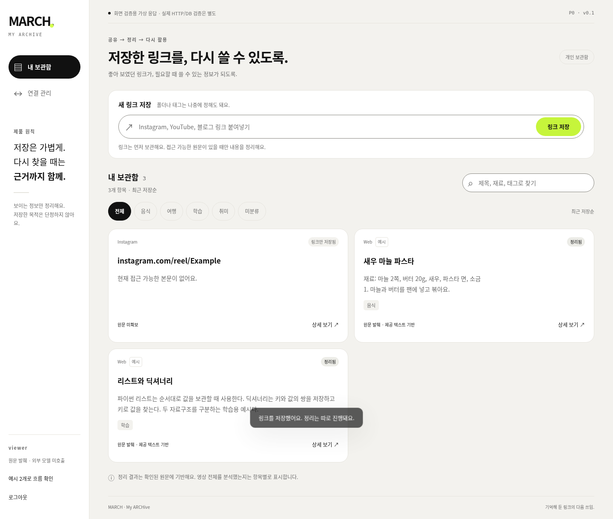
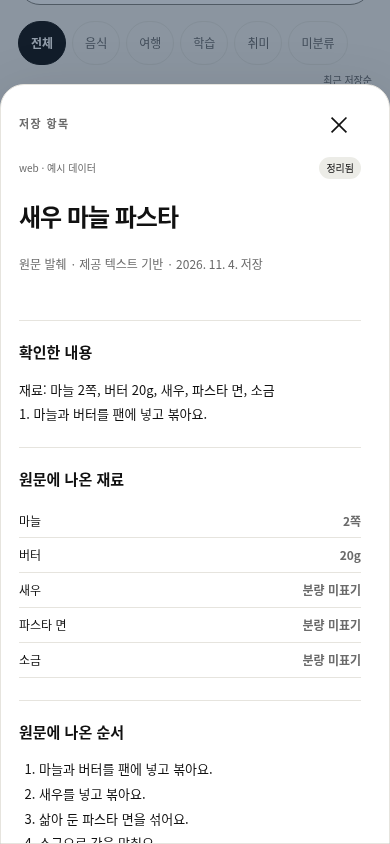

# MARCH · My ARCHive

**저장한 릴스와 링크를, 필요할 때 다시 쓸 수 있는 개인 보관함.**

Instagram에서 봇으로 공유하거나 웹에 URL을 붙여 넣습니다. MARCH는 링크부터 저장하고, 확보한 설명문이나 원문이 있으면 요약·태그·확인된 정보를 정리합니다. 나중에 키워드로 찾고, 카드에서 어떤 원문을 근거로 정리했는지 확인할 수 있습니다.

[제품 기획](docs/PRD.md) · [화면과 디자인](docs/DESIGN.md) · [고민과 결정 기록](docs/DECISIONS.md) · [공유 컬렉션 구상](docs/SHARING.md) · [개발 흐름](CONTRIBUTING.md)

## 사용 흐름

1. **저장** · URL 입력 또는 연결된 Instagram 계정의 DM 공유. 제목·태그·폴더 입력은 선택입니다.
2. **정리** · 확보한 원문으로 요약과 근거를 저장합니다. 원문을 확보하지 못하면 `링크만 저장됨`으로 표시합니다.
3. **다시 찾기** · 제목·태그·정리 내용으로 검색하고 음식·여행·학습·취미로 좁힙니다. 상세에서 원문을 확인하고 개인 제목·태그·메모를 편집합니다.

## 화면

| 데스크톱 보관함 | 모바일 상세 |
| --- | --- |
|  |  |

위 이미지는 **v0.1.0의 예시 데이터 화면**입니다. 이후 디자인은 카드·목록 전환과 로그인·빠른 저장의 서윤 가이드를 추가했습니다. 화면별 동작과 최신 디자인 기준은 [디자인 문서](docs/DESIGN.md)에 있습니다.

## 구현 상태

| 영역 | v0.2 로컬 파일럿 |
| --- | --- |
| 웹 | 로그인, URL 저장, 검색·필터, 상세, 개인 수정·삭제 |
| 백엔드 | FastAPI, SQLite 영속 저장, 독립 Python Worker. Instagram Webhook과 계정 연결 코드는 합성 이벤트로 검증 |
| AI | 확보한 텍스트를 OpenAI GPT-6 Luna로 정리. Gemini 3.5 Flash-Lite와 규칙 기반 무료 발췌 모드 지원 |
| 검증 대기 | 실제 Meta 계정의 DM·미디어 권한, 제3자 릴스 본문·영상 확보, 영상 STT·OCR, 공개 배포 |

## 저장소

| 저장소 | 책임 |
| --- | --- |
| [BE](https://github.com/hodomaroo/BE) | 인증, Capture API, Instagram 연동, DB·작업 큐·비용 원장 |
| **FE** · 이 저장소 | 저장·검색·보관함·상세·연결 관리 화면, 디자인 토큰 |
| [AI](https://github.com/hodomaroo/AI) | 원문 구조화·근거 검증, 모델 어댑터, 품질·비용 비교 |

이 저장소들은 기획·디자인과 개발 흐름을 담은 초기 상태입니다. 위 기능을 구현한 파일럿 코드는 단일 로컬 프로젝트에서 실행됩니다.
